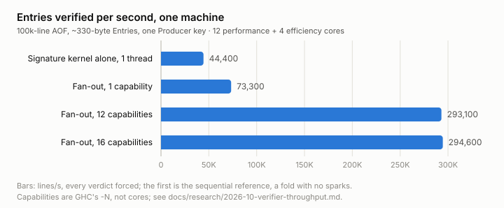
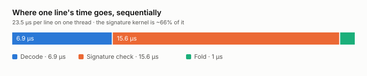
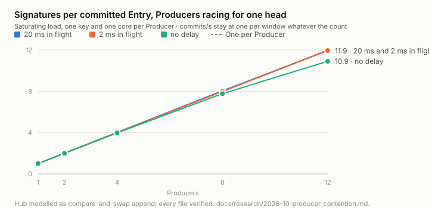
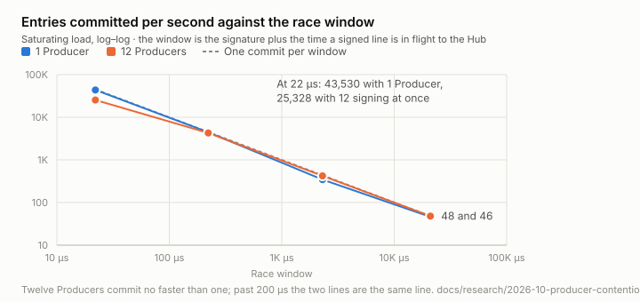
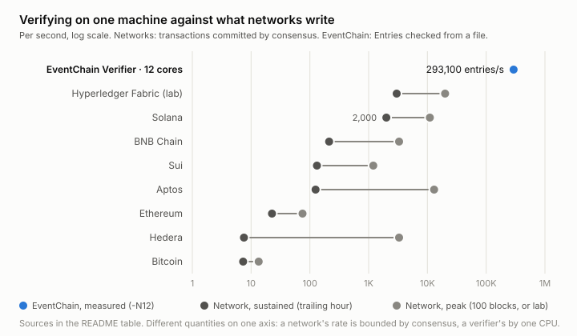

# EventChain

Haskell libraries for producing and independently verifying hash-chained,
signed proof artifacts. An **AOF** is an append-only JSON Lines file: one
signed **Entry** per line, with **Payloads** stored separately. Anyone holding
a copy can check its chain continuity and signatures offline, without
contacting the system that supplied it.

**[Read the EventChain white paper](https://eventchain-protocol.github.io/)**
· [Quick start](#quick-start)
· [Documentation](#documentation)

## What works today

This is an early, library-only implementation of the EventChain protocol
with a two-level proof addendum. There is no CLI, web UI, or hosted service.

- **Produce:** turn a `ChainedEvent` and a signing key into a signed AOF line
  and its hash. The caller owns file IO.
- **Verify offline:** check chain continuity, ECDSA-P256 signatures, and Mint
  envelopes; return typed per-line verdicts. Reject malformed Entries,
  duplicate members, unknown members, and unsupported Revisions.
- **Derive Minted status:** match valid Mint Entries to earlier verified
  targets in a separate pass.

**Not yet implemented:** integrated Payload-commitment verification and the
standalone wire-format document. OpenTimestamps Anchor verification,
authenticator interaction, key registration, and the Hub's storage and
access-control services are outside the current v0 scope. The
[plan](docs/plan.md#milestones) distinguishes remaining work from the broader
protocol described in the white paper.

## Quick start

### Prerequisites

- **GHC 9.12.4** — the compiler this project targets; other releases are not claimed.
- **cabal-install ≥ 3.16** and the usual GHC/C build toolchain.
- **OpenSSL libcrypto ≥ 3.2**, including development files discoverable through
  `pkg-config`. Deterministic ECDSA signing requires this minimum.
- The **OpenSSL CLI** on `PATH` for the conformance tests.
- **An arm64 (AArch64) machine.** The ECDSA-P256 verification kernel is
  vendored [s2n-bignum](https://github.com/awslabs/s2n-bignum) assembly
  ([ADR-0004](docs/adr/0004-crypto-kernels-libcrypto-ffi.md), as amended),
  built by the C toolchain cabal already drives, so nothing to install — but
  only the arm64 sources are vendored, and the crypto package refuses to
  build elsewhere rather than link without its kernel. x86-64 is a separate
  vendoring, claimed when a build has run there.

On macOS with Homebrew:

```sh
brew install openssl@3 pkg-config
export PKG_CONFIG_PATH="$(brew --prefix openssl@3)/lib/pkgconfig${PKG_CONFIG_PATH:+:$PKG_CONFIG_PATH}"
export PATH="$(brew --prefix openssl@3)/bin:$PATH"
```

On Linux, install your distribution's OpenSSL development files and
`pkg-config`; check the actual library release rather than assuming the
system package meets the minimum:

```sh
ghc --numeric-version
cabal --numeric-version
pkg-config --modversion libcrypto
openssl version
```

### Verify an AOF

From the repository root, fetch the package index and open the Verifier in
GHCi. Initial setup downloads dependencies; verification itself is offline.

```sh
cabal update
cabal repl eventchain-verify
```

Cabal starts this REPL in `eventchain-verify/`, so the fixture path below
begins with `../`. Paste these lines at the GHCi prompt:

```haskell
import qualified Data.ByteString.Lazy as BL
import qualified EventChain.Verify as V

aof <- BL.readFile "../vectors/v0-lifecycle.jsonl"
let summarize (V.Sound _) = "Sound"; summarize verdict = show verdict
print (fmap (map summarize) (V.verify aof))
```

Expected result:

```text
Right ["Sound","Sound","Sound","Sound"]
```

Each `Sound` means the corresponding Entry passed continuity and signature
checks. This example abbreviates successful verdicts but retains error
details. It does **not** check Payload contents, human identity, or time of
existence. Type `:quit` to leave GHCi.

The input is the committed [lifecycle AOF](vectors/v0-lifecycle.jsonl), not
mocked data. [Mint vectors](vectors/mint/) also cover valid envelopes,
tampering, unsupported Revisions, and orphan targets.

## How the proof fits together

1. **Produce a proof.** A Producer signs an Entry's commitment and chain
   linkage with its own key. This is the **Produced Proof**. Payload bytes
   stay outside the AOF; the Entry carries their hash and a reference.
2. **Preserve the bytes.** Each Entry's `prev_hash` commits to its predecessor's
   exact line content, framed by [JSON Lines](https://jsonlines.org/).
   Signatures cover the Entry's members except `signature`, canonicalized
   with JCS. The chain hashes bytes; signing canonicalizes members. Do not
   reformat an AOF before verifying it.
3. **Attest later, without rewriting.** A **Mint** Entry carries an
   **Attestation** referencing an earlier Entry by hash, plus a WebAuthn
   assertion envelope. The target is unchanged; its **Minted** status is
   derived, never stored on it.

**Verification has boundaries.** A valid signature establishes attribution
to a key, not that a business claim is true or that the key belongs to a
named person. Mint verification checks the envelope and its target binding;
it is not a complete WebAuthn relying-party ceremony or an identity-directory
check. See the [exact checks and exclusions](docs/adr/0007-mint-envelope-verification.md).
An AOF alone also cannot prove that no later Entries were withheld.

The addendum and byte-level decisions are this implementation's explicit
extensions and clarifications, not claims that the upstream paper specifies
every detail.

## Performance

Measured 2026-10-14 on a 16-core arm64 machine (12 performance + 4
efficiency cores), on mains power. The Verifier reads a 100k-line AOF of
~330-byte Entries under one Producer key and forces every verdict. Method,
raw runs and the same-session comparison against the libcrypto kernel it
replaced are in
[`docs/research/2026-10-fixed-base-verify.md`](docs/research/2026-10-fixed-base-verify.md);
the fold itself and what was ruled out there are in
[`docs/research/2026-10-verifier-throughput.md`](docs/research/2026-10-verifier-throughput.md).
The figures are generated by
[`docs/figures/make_figures.py`](docs/figures/make_figures.py) from those
numbers.

<picture>
  <source media="(prefers-color-scheme: dark)" srcset="docs/figures/verifier-throughput-dark.svg">
  
</picture>

The fold fans 256-line chunks across cores. The only thing a chunk needs
from before it is the digest of the line it follows, which is a function of
raw bytes, so decoding and signature checks never wait on each other.
"Capabilities" are GHC's `-N`, not cores: the signature check is a `safe`
foreign call that releases its capability while the kernel runs, so even
`-N1` overlaps crypto with the next chunk, which is why that row is faster
than the sequential reference above it.

<picture>
  <source media="(prefers-color-scheme: dark)" srcset="docs/figures/line-cost-dark.svg">
  
</picture>

Signature verification is still the larger cost, at two thirds of a line.
It was five sixths: each check is now two fixed-base table walks over a
table built once per Producer key, on vendored, formally verified
[s2n-bignum](https://github.com/awslabs/s2n-bignum) assembly, against the
general scalar multiplication libcrypto's verify performs — 2.25× per
signature on the same machine in the same session. The table is built once
per Producer key per run, and only where it pays: the fold's spine reads the
key each chunk's last line signed with and hands the next chunk that key's
promotion, so a run of one key shares one table, and a key signing too few
lines of a chunk to amortize a table verifies on libcrypto instead, so a Hub
checking one line per append pays libcrypto's price and not a table's. End to end the fold gained 1.43× at one
capability and 1.42× at twelve, measured against the previous kernel built
beside it: once a signature check halves, the fold's own overhead under
parallel load is the larger remaining share, and it is the next thing to
profile rather than the next thing to buy. Decoding
runs inside the fan-out rather than on the sequential spine for the reason
it always did: at a dozen cores, a sequential decode would be the ceiling.

### Many Producers, one head

Everything above is the cost of checking. Appending has a cost of its own
when more than one Producer is signing: each Entry signs the hash of the
line before it, so a Producer must know the head before it signs, and if
another Producer's line lands first the signature covers a stale head and
has to be made again. That makes the chain serial through the Producer's
key, and it is the protocol's design rather than this implementation's: the
upstream paper appends through a single-threaded processor so that the
chain is totally ordered, and the signed `prev_hash` is what lets a holder
check order without trusting the Hub. Both properties stay. The ceiling
below is the price of them, measured so it can be planned for, not a
problem this repository intends to engineer away. The same bench package
measures it, with a Hub modelled as a compare-and-swap append and each
Producer on its own key and its own core. Method, raw table and what was
ruled out are in
[`docs/research/2026-10-producer-contention.md`](docs/research/2026-10-producer-contention.md).

<picture>
  <source media="(prefers-color-scheme: dark)" srcset="docs/figures/producer-contention-dark.svg">
  
</picture>

Three things the numbers settle:

- **Writes never amplify.** A rejected attempt writes nothing, and every
  file the bench wrote held exactly one line per committed event, verified.
- **One head commits at one Entry per race window however many Producers
  feed it.** The window is the signature plus the trip to the Hub. In this
  process that is about 45,000 Entries per second with one Producer and
  25,000 with twelve signing at once. With 2 ms between Producer and Hub it
  is about 420 per second, and with 20 ms about 47, at every Producer
  count. Offer 30,000 events per second across twelve Producers and 25,500
  commit, at eleven signatures per Entry. Producers add signing capacity,
  not commit capacity.
- **"One signature per event" is a regime, not a constant.** At 300 events
  per second across twelve Producers an Entry costs 1.2 signatures; at
  3,000, 2.3; at the ceiling, one per Producer. And the append rule does not
  share: at twelve Producers with 20 ms in flight, one Producer committed
  nothing in two seconds while another's worst wait was 1.7 s.

<picture>
  <source media="(prefers-color-scheme: dark)" srcset="docs/figures/commit-ceiling-dark.svg">
  
</picture>

For planning, the chart above is the one to read: the window is the
signature plus the trip to the Hub, and a deployment's commit rate is one
over that window, whatever its Producer count.

A Producer can take the trip out of the window by signing a batch of events
chained among themselves and submitting them together. Measured the same
way (`cabal run eventchain-bench:batching`, on battery, so absolutes are
about two thirds of mains): across 20 ms a batch of 100 commits 84× what
single events do and a batch of 3000 commits 500×, and with nothing in
flight a batch commits exactly what single events do. Every batch size
converges on the same ceiling, one signer's signature rate, because the
batch is signed one Entry at a time and racing Producers still discard all
but one batch per round. The price is latency of a batch's signing time per
event and worse starvation at twelve Producers. Numbers and what they do not
change are in
[`docs/research/2026-10-producer-batching.md`](docs/research/2026-10-producer-batching.md).

### Against networks

An AOF is not a blockchain and the Verifier is not a consensus node, so the
chart below puts two different quantities on one axis on purpose: what a
network commits per second, bounded by consensus, against what one machine
re-checks per second from a file, bounded by one CPU. The question it
answers is whether a holder can keep up with any of these write rates
without infrastructure.

<picture>
  <source media="(prefers-color-scheme: dark)" srcset="docs/figures/versus-networks-dark.svg">
  
</picture>

| System | Sustained, tx/s | Peak, tx/s | What the numbers are |
| --- | --- | --- | --- |
| EventChain Verifier, one 12-core machine | 293,100 | — | Entries verified from a file, `-N12`, this repository's bench |
| Hyperledger Fabric | 3,000 | 20,000 | Fabric 1.2 baseline and the re-architected FastFabric, both in a lab ([arXiv:1901.00910](https://arxiv.org/abs/1901.00910)) |
| Solana | 2,000 | 11,000 | Non-vote transactions, trailing hour and best 100 blocks ([Chainspect](https://chainspect.app/dashboard), read 2026-10-13); 5.2 billion non-vote transactions in August 2026 ≈ 1,940/s sustained for the month ([Solana Compass](https://solanacompass.com/news/solana-processes-52-billion-non-vote-transactions-in-august-surpassing-all-other-l1s-and-l2s-combined)) |
| BNB Chain | 213 | 3,300 | Chainspect, as above |
| Sui | 132 | 1,200 | Chainspect, as above |
| Aptos | 125 | 13,000 | Chainspect, as above |
| Ethereum | 22.7 | 74.9 | Chainspect, as above; layer 1 only |
| Hedera | 7.56 | 3,300 | Chainspect, as above |
| Bitcoin | 7.31 | 13.48 | Chainspect, as above |

At that rate one machine re-verifies Solana's record month, 5.2 billion
transactions, in about eleven and a half hours, and stays ahead of every
sustained write rate in the table by at least 40×. Chainspect's "theoretical" ceilings
(65,000 for Solana, 160,000 for Aptos) are omitted: they are protocol claims,
not measurements, and the chart carries only measured values.

What the comparison does not say: a network's throughput buys global
agreement on ordering among parties that do not trust each other, and the
Verifier buys none of that. It checks that one file is internally consistent
and signed by whom it says. The Hub orders Entries; the chain makes the order
tamper-evident after the fact. Those are different guarantees at different
costs, and the chart is about the cost of checking, not the cost of agreeing.

## Packages and public entry points

Three libraries share one Cabal project:

| Package | Role | Start here |
| --- | --- | --- |
| [`eventchain`](eventchain/) | Producer: `ChainedEvent` → signed line and line hash. Never parses JSON. | [`EventChain`](eventchain/src/EventChain.hs), [`produce`](eventchain/src/EventChain/Produce.hs) |
| [`eventchain-verify`](eventchain-verify/) | Verifier: AOF bytes → typed verdicts, chunks fanned across cores; resumes from a Checkpoint; separate Minted-status derivation. | [`verify`](eventchain-verify/src/EventChain/Verify.hs), [`verifyFrom`](eventchain-verify/src/EventChain/Verify.hs), [`mintedStatus`](eventchain-verify/src/EventChain/Verify/Minted.hs) |
| [`eventchain-crypto`](eventchain-crypto/) | Shared kernels through one batched FFI seam: SHA-256 and signing on libcrypto, ECDSA-P256 verification on vendored s2n-bignum assembly from a precomputed key; plus byte/hash/key types. | [`EventChain.Crypto`](eventchain-crypto/src/EventChain/Crypto.hs) |

Two more packages ship nothing and nothing depends on them: [`gates/`](gates/)
grades the boundaries below, and [`eventchain-bench/`](eventchain-bench/)
measures the Verifier end to end (`cabal run eventchain-bench:verify`, then
with `-- +RTS -N` for every core) and what appending costs when many
Producers race for one head (`cabal run eventchain-bench:contention`) and
what batching buys against that (`cabal run eventchain-bench:batching`).

**The Producer and Verifier share no format logic.** Their member
vocabularies, canonicalizers, and codecs are implemented separately. Sharing
a broken codec would let both sides agree on the same mistake; independent
implementations make agreement across committed vectors useful evidence.
Crypto is deliberately shared. The [independence decision](docs/adr/0005-verifier-is-a-separate-package.md)
explains the boundary, and [`gates/`](gates/) enforces it through tests.

The Verifier's continuity and signature pass streams through the AOF.
Minted-status derivation is separate because it retains an in-memory index
that grows with the number of Entries.

## Documentation

- **[White paper](https://eventchain-protocol.github.io/)** — the upstream
  protocol, motivation, and broader system model.
- **[Vocabulary](CONTEXT.md)** — the precise meanings of Entry, Producer,
  Produced Proof, Mint, and other domain terms.
- **[Architecture decisions](docs/adr/)** — byte-level rules, package
  independence, Revisions, and Mint verification.
- **[Vectors](vectors/)** — committed AOFs consumed by the Verifier and
  checked against the Producer's output.
- **[Implementation plan](docs/plan.md)** — package contracts, milestones,
  and remaining work; a plan, not a list of shipped features.

## Contributing

Start with the [vocabulary](CONTEXT.md) and [architecture decisions](docs/adr/).
Preserve the Producer/Verifier split: sharing format code to fix a divergence
would remove the evidence the tests are meant to provide.

From the repository root, with the prerequisites above:

```sh
cabal build all
cabal test all
```

The suites cover crypto known answers, both canonicalizers against an
independent JCS oracle, Producer output against OpenSSL, Verifier behavior,
Mint envelopes, and structural dependency gates. Include a reproducing AOF
or test case when reporting a verification discrepancy; never include private
keys or confidential Payloads.

## License

[BSD-3-Clause](LICENSE).
